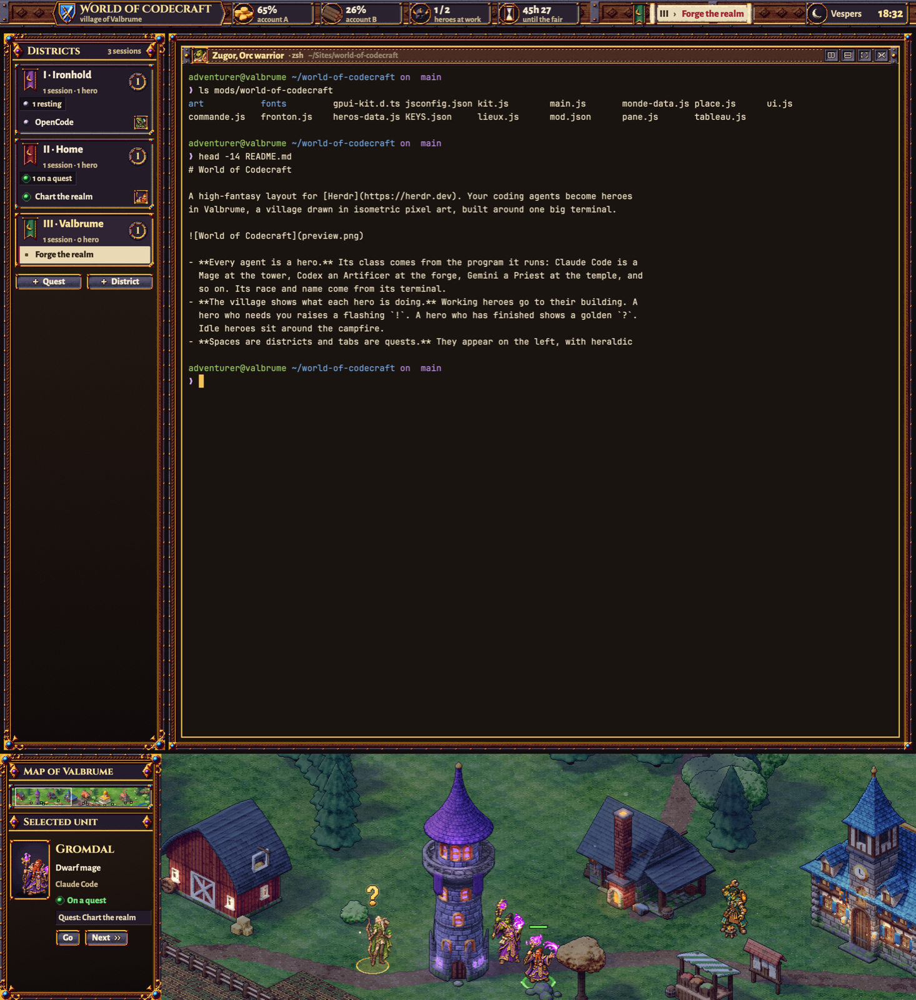

# World of Codecraft

A high-fantasy layout for [Herdr](https://herdr.dev). Your coding agents become heroes
in Valbrume, a village drawn in isometric pixel art, built around one big terminal.

- **Every agent is a hero.** Its class comes from the program it runs: Claude Code is a
  Mage at the tower, Codex an Artificer at the forge, Gemini a Priest at the temple, and
  so on. Its race and name come from its terminal.
- **The village shows what each hero is doing.** Working heroes go to their building. A
  hero who needs you raises a flashing `!`. A hero who has finished shows a golden `?`.
  Idle heroes sit around the campfire.
- **Spaces are districts and tabs are quests.** They appear on the left, with heraldic
  banners.
- **The village has days and nights.** It follows your clock, with lit windows, a
  glowing forge and smoking chimneys.
- **It comes with a warm terminal theme**: dark oak background, parchment text and a
  gold cursor.

## Install

Ask your agent to add `herdr.dev/layouts/kevinpardo/world-of-codecraft`, or install it
by hand:

1. Copy `layouts/World-of-Codecraft.json` and `layouts/World-of-Codecraft.png` to
   `~/.config/herdr-app/layouts/`.
2. Copy `themes/World-of-Codecraft.json` to `~/.config/herdr-app/themes/`.
3. Copy `mods/world-of-codecraft/` to `~/.config/herdr-app/mods/`.
4. Merge `mods/world-of-codecraft/KEYS.json` into your `keys.json`. It adds two keys:
   `ctrl-shift-j` toggles the village and `ctrl-shift-b` toggles the left column.
5. Run `herdr-app check ~/.config/herdr-app/mods/world-of-codecraft`, then switch with
   `herdr-app do layout.switch '{"name":"World-of-Codecraft"}'`.

## What it reads

The mod does not access the network and runs no programs. It reads only one file
outside its own folder, and only if that file exists: the Claude quota files written by
the author's two-account setup, cduo, at `~/.local/state/claude-duo/quota-{A,B}.json`.
When they are present, the top bar shows two quota gauges. Otherwise the gauges are
hidden.

## Credits

Code and art by Kevin Pardo, MIT licensed. The heroes were made with AI image
generation, then cut, animated and graded by hand. The fonts are Cinzel, Alegreya Sans,
Jacquard 24 and Jersey 15, all under the SIL Open Font License.

World of Codecraft is an original work and a playful nod to the MMOs we grew up with.
It is not affiliated with or endorsed by any game publisher.
