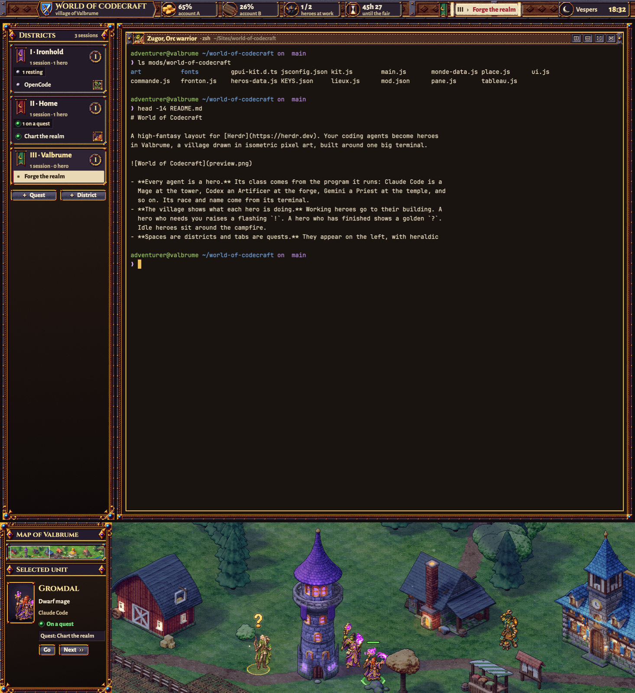

# World of Codecraft

A high-fantasy MMO village for Herdr. One big terminal sits in a carved oak and gold
frame. Below it, Valbrume, an isometric pixel-art village, shows every coding agent as
a hero of a race and a class, working at its building. The top bar is a strategy-game
resource bar, spaces are heraldic districts on the left, and day turns to night with
the clock. The art is original: it imitates no existing game.

## What you see

- **Top bar** (48 px, window drag, traffic lights at 16,23). A carved beam with:
  - the crest and the logo "WORLD OF CODECRAFT" in Cinzel Decorative, with
    "village of Valbrume" under it;
  - resource plaques, each an icon, a value and a caption: Gold (Claude account A),
    Wood (account B), Heroes ("1/2", heroes at work out of all heroes) and Fair (time
    until the weekly quota reset);
  - a parchment scroll in the middle with the shown district and quest;
  - on the right, an alert when a hero waits, then the sun or the moon, the canonical
    hour (Matins, Lauds, Terce, Sext, None, Vespers, Compline) and the clock.

  Gold, Wood and Fair are optional and hidden when there is no quota data.
- **Left column** (262 px, iron-framed panel). The "Districts" heading with a session
  count. Then one card per space:
  - a cloth banner with a gold charge, picked by hashing the space;
  - `I · name`, the session and hero counts, and a medallion with the quest count;
  - status chips ("on a quest", "resting", "need help", "to turn in");
  - one row per tab with the hero portrait. The shown tab is highlighted.

  The card frame turns gold when the space is shown and ruby when a hero needs you.
  At the bottom are "+ Quest" (new tab) and "+ District" (new space) buttons.
- **Terminal** (centre). The tab block sits inside four `rail` blocks (14 px gilded
  moulding). Panes use JetBrains Mono 14 on dark oak `#1a1411`, theme
  `World-of-Codecraft`. Each pane header (30 px) is an oak plank with rivets and holds:
  - the hero portrait;
  - "Name, Race class", the program and a state gem with its label;
  - the tab title and folder;
  - iron buttons: split right, split down, zoom and close.
- **Village** (bottom, 400 px). On the left, a command panel:
  - "Map of Valbrume": a minimap with unit dots and the camera frame;
  - "Selected unit": the focused agent as a full-length portrait card with name, class
    and race, program, state and quest, plus Go and Next buttons.

  On the right, the world: 3000×400 logical px with art pixels at 2×, panning
  horizontally. It contains:
  - buildings: town hall with belfry, mage tower (round, violet cone), forge workshop,
    barracks, Temple of Dawn, tavern, barn with fenced fields, market stalls, a well
    and a notice board;
  - a campfire, a road, a river and a forest;
  - in the top-left corner, a chronicle of the last 4 events on dark tags.

## How it behaves

- **Class comes from the program:**
  - Claude Code: Mage, at the Mage Tower
  - Codex: Artificer, at the Forge Workshop
  - Gemini: Priest, at the Temple of Dawn
  - OpenCode, pi, amp, cursor: Ranger, at the barn and fields
  - any other agent: Rogue, at the market
  - plain shells: Warriors on guard at the barracks
- **Race and name** come from a hash of the terminal address. The races are Elf, Orc,
  Human, Undead and Dwarf.
- **States:**
  - **working**: the hero plays its `work` animation at its building.
  - **idle**: it sits by the campfire (`rest`).
  - **blocked**: `idle` with a red ring, a flashing `!` and a speech bubble.
  - **done**: `idle` with a gold ring, a `?` and sparkles.
- **Movement:** when its spot changes, a hero walks there. Close spots are reached in
  a straight line. Farther ones follow the road, with a 4-direction walk animation.
  Each road leg is a native `left`/`top` transition.
- **Selection:** the selected unit is the focused agent. It gets a green ring and a
  health bar, and the camera glides to it. The scroll wheel pans, and clicking the
  minimap moves the view.
- **Clicks:**
  - a unit: `agent.focus` (`pane.focus` for shells)
  - double-click the tower, the forge or the barracks: recruit with `tab.new` (claude,
    codex or a shell)
  - a district card: `space.select`
  - a tab row: `tab.select`
  - a chronicle line: focus that hero
  - the top alert: focus the first hero who is waiting
- **Day and night:** night tiles crossfade over day tiles (opacity 1 at night, 0.55 at
  dawn and dusk). Window and campfire glows pulse, and chimneys smoke.
- **Chronicle:** it logs arrivals, departures and state changes ("[Mage Tower] Gromdal,
  Dwarf mage (Claude Code) sets out on a quest"). It is kept in the store key
  `valbrume.chronique`.
- **Keys** (`layout:World-of-Codecraft`): ctrl-shift-j toggles the village, and
  ctrl-shift-b toggles the left column.

## Built from

- **Layout tree:** a root column made of:
  - `fronton` (block, 48 px);
  - `bourg` (row, 6 px padding and gap), holding `tableau` (block, 262 px, min 200,
    max 420) and `arene` (column: four `rail` blocks around the `main` tab block);
  - `place` (block, 400 px).

  The root has `titlebar: none`, background `#120c0e`, `ui_font` Alegreya Sans and a
  PNG `preview`.
- **The mod** is `mods/world-of-codecraft`, one mod with roles picked by `props.role`:
  - `fronton.js`: the top bar
  - `tableau.js`: the districts column
  - `rail`: the gilded moulding
  - `place.js`: the world and the command panel, with `commande.js`
  - `pane.js`: the pane header

  The shared code is:
  - `kit.js`: palette, fonts, hero identity, hours and the optional quota reader;
  - `ui.js`: frames built from 4 corners and cropped edge strips, since Herdr has no
    9-slice;
  - `lieux.js`: unit spots, the road and building hit boxes;
  - `heros-data.js` and `monde-data.js`: animation frame tables and world tiles,
    generated.
- **Herdr API:**
  - data: `spaces()`, `agents()`, `panes()`, `focused()` and the store;
  - commands: `agent.focus`, `agent.next`, `pane.focus`, `space.select`, `tab.select`,
    `tab.new`, `space.new`, `pane.split`, `pane.zoom` and `pane.close`.
- **Timers:** one shared 100 ms timer runs only while a visible unit animates or walks,
  and stops when `place` is hidden. The clock ticks every 30 s; the sky and quotas
  update every 60 s.
- **Files read:** only `~/.local/state/claude-duo/quota-{A,B}.json` (cduo), and only if
  it exists. The mod makes no network calls and runs no programs.
- **Art** (`art/`):
  - heroes: 30 race×class sprites with `idle`, `rest`, `work` and 4-way walk frames,
    plus night-graded copies;
  - the baked world: day and night tiles, front cut-outs for depth, the minimap;
  - UI chrome: PNGs at 2×;
  - SVG icons.

  Fonts (OFL, `fonts/`): Cinzel Decorative, Cinzel, Alegreya Sans, Jacquard 24 and
  Jersey 15.

## Watch out

- **Depth:** units sort by their y position. Front cut-outs of buildings are drawn
  again above units standing behind them.
- **Frame swaps:** all frames of the current animation are stacked at opacity 0/1, so
  a swap never loads an image.
- **Breathing:** heroes without frames show the standing sprite with a native 1 px
  breathing loop.
- **Demo:** `props: {role: "place", demo: true, heure: 22}` adds 8 demo heroes at
  night, and `demo: "marche"` makes them walk.

## Done when

- `herdr-app check mods/world-of-codecraft` passes and `herdr-app status` shows no
  errors.
- Each agent appears at its class building. Blocked shows `!` and a red ring. Focusing
  another agent glides the camera, and a minimap click moves it.
- Without cduo files, the top bar shows no empty quota plaques.
